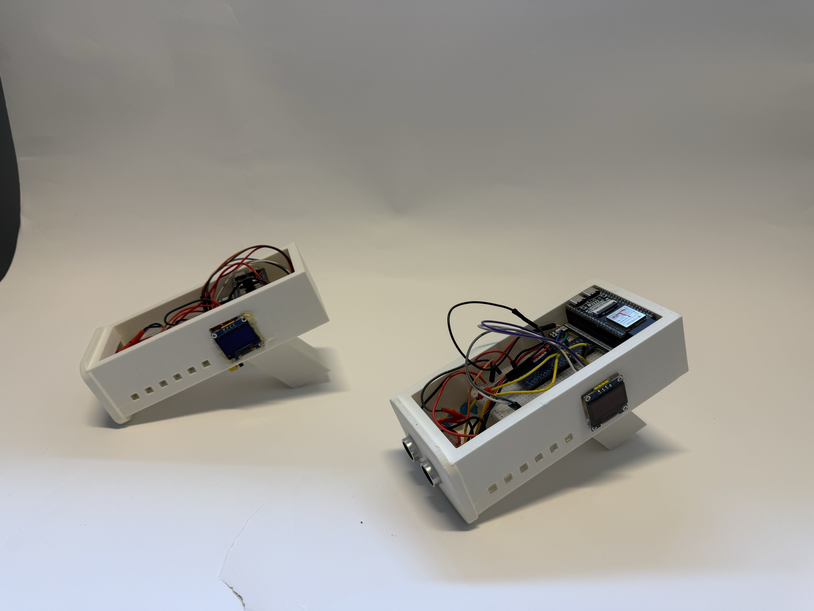
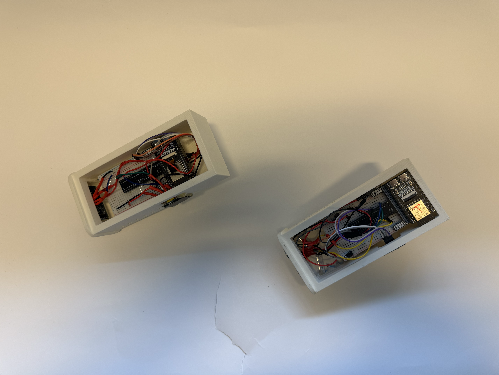
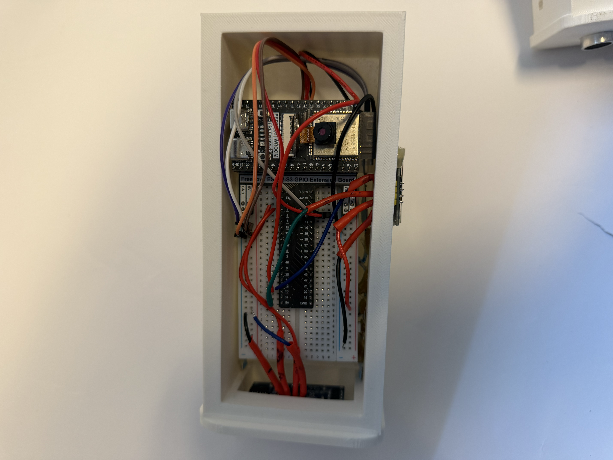
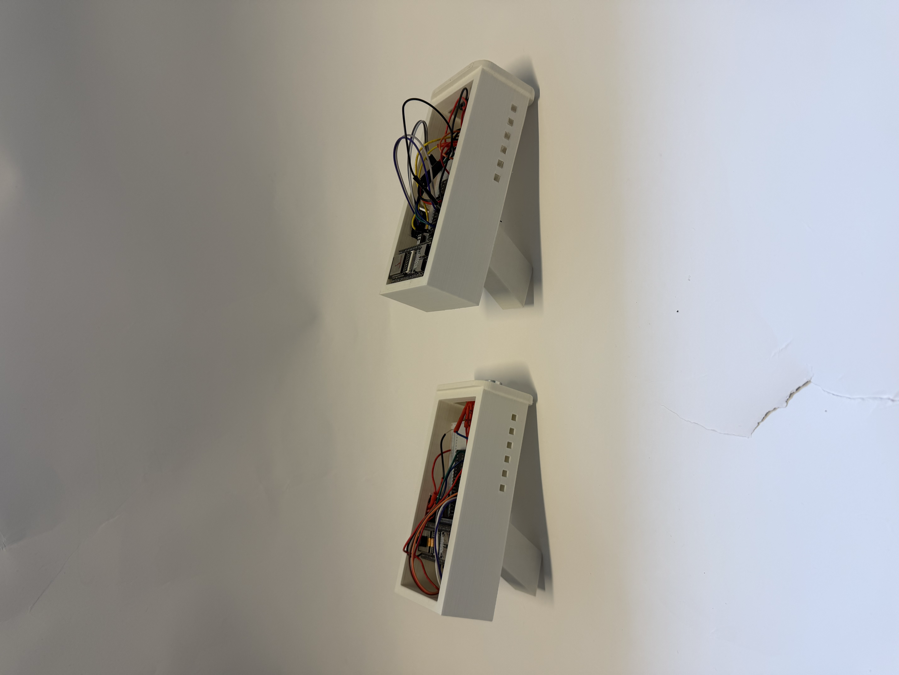
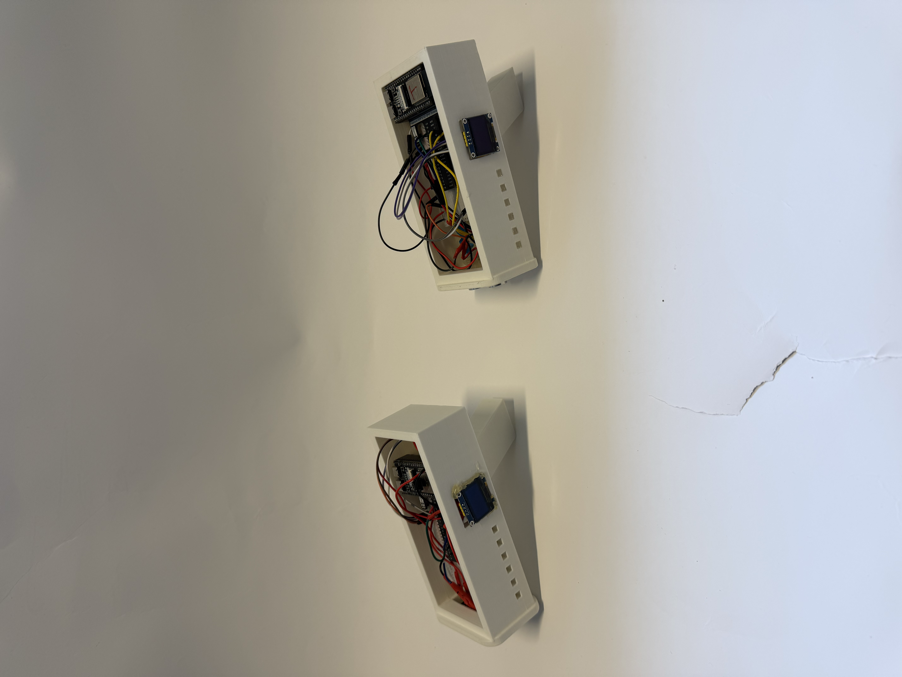
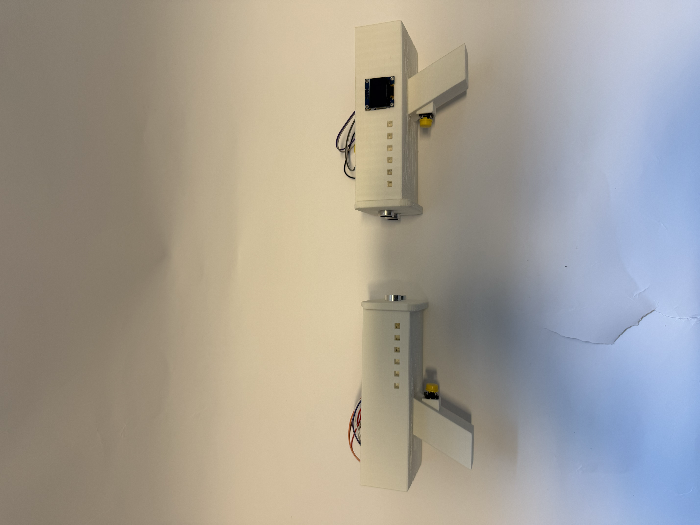
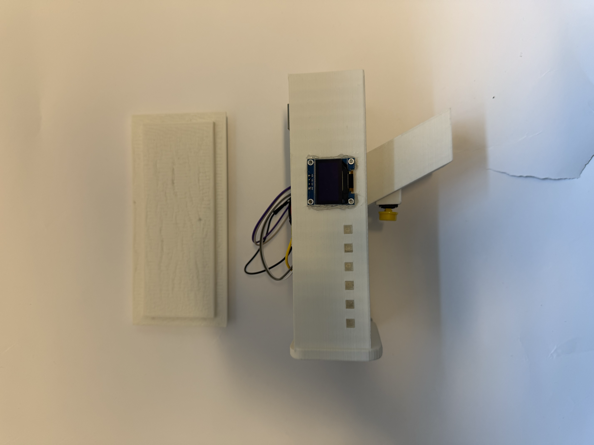

# 1. lýsing
Byssuleikurinn hefst þegar ýtt er á „Start“ á vefinu. Þá reyna leikmenn að giska á ákveðna vegalengd í sentímetrum. Sá sem er næst réttri vegalengd vinnur leikinn.
# 2. Vídeo

# 3. Ljósmyndir

# 4. íhlutalisti

### Fyrir byssur
- 2x Esp32
- 2x Breadboard
- 2x Buttons
- 2x UDS (Ultrasonic Distance Sensor)
- Led strips 2x
- 2x Oled screens
- 2x Servo
### Server
- 1x RasberryPi 4

# 5. Flæðirit
.drawio.png)

# 6. Hönnunarteikningar

# 7. Cóðar

